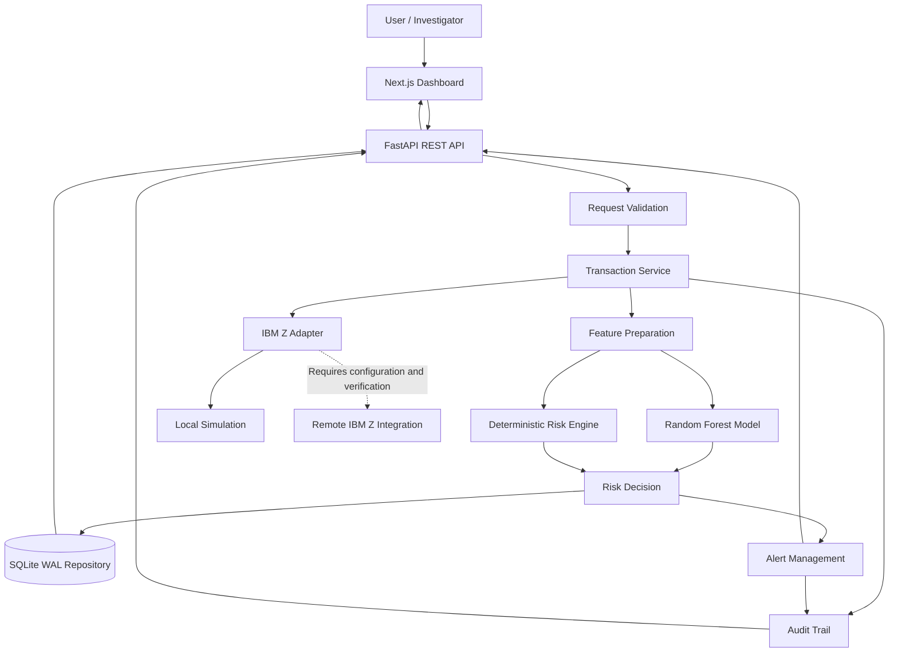

# SentinelZ AI
### Explainable AI-Powered Transaction Risk Intelligence

<p align="center">
  <strong>IBM Z Datathon 2026</strong><br />
  An explainable transaction-risk platform combining machine learning, deterministic policies, evidence-backed decisions, and auditable investigation workflows.
</p>

<p align="center">
  
  
  
  
  
  
</p>

---

## Table of Contents

- [Overview](#overview)
- [Problem](#problem)
- [Solution](#solution)
- [Features](#features)
- [Architecture](#architecture)
- [Explainable AI](#explainable-ai)
- [Model Evaluation](#model-evaluation)
- [Technology Stack](#technology-stack)
- [Project Structure](#project-structure)
- [Getting Started](#getting-started)
- [Environment Configuration](#environment-configuration)
- [Run Locally](#run-locally)
- [API Documentation](#api-documentation)
- [Testing](#testing)
- [Public Deployment](#public-deployment)
- [IBM Z and LinuxONE](#ibm-z-and-linuxone)
- [Security and Data Integrity](#security-and-data-integrity)
- [Limitations](#limitations)
- [Roadmap](#roadmap)
- [Team](#team)
- [License](#license)

---

## Overview

**SentinelZ AI** is an AI-assisted transaction-risk intelligence platform designed to demonstrate how machine learning, deterministic risk policies, evidence-backed explanations, and audit trails can support financial transaction monitoring.

The application evaluates transaction information, derives risk indicators, obtains an ML prediction, applies configured decision policies, and records supported decisions and investigation actions.

SentinelZ AI separates a model output from a policy decision so investigators can inspect the information behind a recommendation.

> **Project status:** This is a demonstration and engineering prototype using synthetic transaction data. It is not a production banking fraud-prevention system.

## Problem

Financial transaction monitoring must identify suspicious activity while avoiding unnecessary friction for legitimate customers. Investigators also need consistent policies, understandable explanations, reliable transaction processing, and records they can review later.

A model score alone does not provide a complete investigation workflow. Evidence, explicit policy decisions, alert management, and traceable outcomes are also important.

## Solution

SentinelZ AI combines an ML pipeline with deterministic risk evaluation and backend persistence:

1. Accept or simulate transaction data.
2. Validate transaction attributes.
3. Prepare model features.
4. Produce an ML prediction.
5. Evaluate deterministic risk indicators.
6. Apply configured decision thresholds and policies.
7. Return a structured decision and explanation.
8. Persist supported transaction, alert, and audit records.
9. Present results in an operations dashboard.

The model assists risk evaluation; it does not independently replace the decision policy.

## Features

### Transaction Intelligence Dashboard
- Transaction activity summaries
- Risk distribution visualizations and trends
- Processing metrics where available
- Backend and model health indicators
- Recent transactions and alerts

Metrics should come from actual backend responses or be explicitly labelled as demonstration data.

### Transaction Explorer
- Search and risk/channel filters
- Bounded transaction listings
- Transaction selection
- Navigation to detailed risk analysis

### Explainable Risk Analysis
- Input transaction attributes
- Deterministic risk indicators
- ML prediction and displayed score
- Policy-based recommendation

Explanations must reflect actual model outputs and implemented rules, not invented feature contributions.

### Deterministic Decision Engine
The reported configuration includes these application thresholds:

| Parameter | Reported value |
|---|---:|
| High-risk threshold | 0.450 |
| Medium-risk threshold | 0.270 |

These are project-specific settings, not universal financial risk standards. Their suitability requires evaluation for the intended use case.

### Alert Investigation
The reported workflow supports:
- Start review
- Resolve
- Reopen

Status updates are persisted through the backend and generate corresponding audit activity, according to the project engineering report.

### Audit Trail
The application records supported transaction and investigation activity, including available action types, actors, and timestamps. Ordinary SQLite records are not inherently tamper-proof or cryptographically immutable.

### Model Evaluation
The evaluation view reports metrics such as precision, recall, F1, false-positive rate, ROC-AUC, PR-AUC, and a confusion matrix.

### Demonstration Scenarios
The simulator includes scenarios such as normal transaction, unusual amount, velocity burst, device risk, and cross-border wire. These are synthetic demonstrations, not live customer transactions.

### Adapter Visibility
The adapter architecture distinguishes local simulation from remote IBM Z integration. Remote execution must be explicitly configured and verified; it must not silently fall back to local simulation.

---

## Architecture



This is a logical architecture diagram. It does not mean that remote IBM Z infrastructure is currently connected.

## Transaction Flow

```text
Transaction Input
       |
       v
Schema Validation
       |
       v
Feature Preparation
       |
       +-----------------------+
       |                       |
       v                       v
ML Prediction          Deterministic Rules
       |                       |
       +-----------+-----------+
                   |
                   v
          Risk Decision Engine
                   |
                   v
        Decision and Explanation
                   |
                   v
       Transaction / Alert Storage
                   |
                   v
             Audit Records
                   |
                   v
          Operations Dashboard
```

## Explainable AI

A meaningful risk decision should help answer:

1. **What was observed?** Transaction attributes and derived features.
2. **What indicated risk?** Deterministic rules triggered by those attributes.
3. **What did the model predict?** Its output for the prepared feature vector.
4. **What action was recommended?** The policy decision and supporting reasoning.

A model output is not automatically a calibrated probability of fraud. A normalized display score may not equal the raw model prediction. Label scores according to their actual definitions.

## Model Evaluation

The previous engineering report recorded the following held-out evaluation on synthetic demonstration data:

| Metric | Previously reported result |
|---|---:|
| Evaluation sample size | 900 |
| Positive cases | 33 |
| Negative cases | 867 |
| Precision | 25.93% |
| Recall | 21.21% |
| F1 score | 0.2333 |
| False-positive rate | 2.31% |
| PR-AUC | 0.2197 |
| ROC-AUC | 0.6862 |

**These are historical reported results, not a guarantee that the current model artifact reproduces them.** Re-run evaluation against the exact deployed artifact before presenting them as current results.

At the reported threshold, 7 of 33 positive cases were detected and 26 were missed. The reported precision means 7 of 27 flagged cases were positive in that evaluation.

The benchmark uses synthetic data generated from assumed distributions and labels. It does not establish performance on real banking data or production readiness.

### Model improvement priorities
- Evaluate on independent and representative data.
- Examine false negatives and false positives.
- Check preprocessing consistency and data leakage.
- Evaluate calibration before calling scores probabilities.
- Document threshold-selection methodology.
- Measure inference performance under a defined environment.
- Preserve reproducible training and evaluation artifacts.

## Technology Stack

### Frontend
| Technology | Responsibility |
|---|---|
| Next.js 16 | Web application framework |
| React 19 | UI components |
| TypeScript | Static type checking |
| Tailwind CSS | Styling |
| Recharts | Data visualization |

### Backend
| Technology | Responsibility |
|---|---|
| Python | Backend and ML runtime |
| FastAPI | REST API |
| Pydantic | Request/response validation |
| SQLite | Database |
| SQLite WAL | Database journaling mode |
| scikit-learn | ML pipeline |
| pytest | Automated tests |

### Infrastructure
| Component | Purpose |
|---|---|
| Local simulation adapter | Development and demonstration |
| IBM Z adapter interface | Separates local and remote execution paths |
| Vercel | Optional/planned frontend hosting |
| Render | Optional/planned backend hosting |

The hosting providers above are deployment options, not claims that a public deployment already exists.

## Project Structure

The following reflects the reported repository organization; verify it against your current checkout.

```text
sentinelz-ai/
├── app/
│   ├── layout.tsx
│   ├── page.tsx
│   └── globals.css
├── components/
├── lib/
│   └── api.ts
├── backend/
│   ├── app/
│   │   ├── main.py
│   │   ├── config.py
│   │   ├── schemas.py
│   │   ├── routes/
│   │   │   ├── health.py
│   │   │   ├── transactions.py
│   │   │   ├── predictions.py
│   │   │   ├── alerts.py
│   │   │   ├── metrics.py
│   │   │   └── audit.py
│   │   ├── engine/
│   │   ├── ml/
│   │   │   └── artifacts/
│   │   ├── adapters/
│   │   └── repository/
│   ├── tests/
│   └── requirements.txt
├── docs/
│   ├── engineering_audit.md
│   ├── security_review.md
│   └── linuxone_deployment_guide.md
├── package.json
├── README.md
└── .gitignore
```

## Getting Started

### Prerequisites
- Node.js compatible with the project's Next.js version
- npm
- Python compatible with backend dependencies
- Git

The engineering report previously recorded tests in a Windows environment with Node.js 20 and Python 3.14. Verify dependency compatibility for the current environment before choosing a production runtime.

### 1. Clone the repository

Replace the placeholders with your actual repository URL and directory:

```bash
git clone YOUR_GITHUB_REPOSITORY_URL
cd YOUR_REPOSITORY_DIRECTORY
```

### 2. Install frontend dependencies

From the directory containing `package.json`:

```bash
npm install
```

### 3. Install backend dependencies

From the repository root in Windows PowerShell:

```powershell
cd backend
py -m venv .venv
.\.venv\Scripts\python.exe -m pip install --upgrade pip
.\.venv\Scripts\python.exe -m pip install -r requirements.txt
cd ..
```

Use a Python version supported by the actual dependency set.

## Environment Configuration

Inspect `backend/app/config.py` and `lib/api.ts` to confirm the exact environment variables required by your current code. Do not commit credentials or secrets.

The reported frontend configuration uses `NEXT_PUBLIC_API_BASE_URL`. For local development, the value may be:

```dotenv
NEXT_PUBLIC_API_BASE_URL=http://127.0.0.1:8000
```

Confirm whether the API client expects a base URL or a URL including an `/api` path before setting it.

## Run Locally

Run the backend and frontend in separate PowerShell terminals.

### Terminal 1 — FastAPI

From the repository root:

```powershell
$env:PYTHONPATH = "backend"
.\backend\.venv\Scripts\python.exe -m uvicorn app.main:app --app-dir backend --host 127.0.0.1 --port 8000 --reload
```

Expected local addresses:
- API: `http://127.0.0.1:8000`
- Interactive API documentation: `http://127.0.0.1:8000/docs`

### Terminal 2 — Next.js

From the repository root:

```powershell
npm run dev
```

Open `http://localhost:3000`.

### Health check

The previous report identifies `/api/health` as the health endpoint:

```powershell
Invoke-RestMethod http://127.0.0.1:8000/api/health
```

If the route differs in your current code, use the endpoint registered in `backend/app/routes/health.py`.

## API Documentation

FastAPI serves interactive documentation while the backend is running:

`http://127.0.0.1:8000/docs`

Reported API modules include health, transactions, predictions, alerts, metrics, and audit.

| Method | Endpoint | Purpose |
|---|---|---|
| `GET` | `/api/health` | Health information |
| `GET` | `/api/engine/config` | Risk engine configuration |
| `PATCH` | `/api/alerts/{alert_id}` | Update alert status |

Discover other routes from the running OpenAPI specification rather than assuming their paths.

## Testing

### Backend tests

From the repository root in PowerShell:

```powershell
$env:PYTHONPATH = "backend"
.\backend\.venv\Scripts\python.exe -m pytest backend\tests -v
```

The previous engineering report recorded 81 passing tests and three warnings. That result is historical; rerun tests to verify the current code.

### TypeScript validation

```powershell
npx tsc --noEmit
```

### Production build

```powershell
npm run build
```

A successful build does not prove that a deployed backend is reachable or that every workflow functions correctly.

### Integration smoke test
1. Simulate or submit a transaction.
2. Inspect its risk score and decision.
3. Open the explanation.
4. Verify whether an alert was generated.
5. Update the alert status.
6. Confirm the update persists.
7. Inspect the audit record.
8. Restart the backend and verify persistence where configured.

## Public Deployment

A deployment is complete only after the actual deployed services have been tested.

### Frontend — Vercel
1. Push the verified project to GitHub.
2. Import the repository into Vercel.
3. Configure the frontend project root.
4. Set the frontend API URL to the actual backend URL.
5. Deploy and test the generated HTTPS URL.

### Backend — Render
A typical configuration for the reported repository layout is:

| Setting | Value |
|---|---|
| Root directory | `backend` |
| Build command | `pip install -r requirements.txt` |
| Start command | `uvicorn app.main:app --host 0.0.0.0 --port $PORT` |

Verify the actual entry point, runtime, and dependencies before deployment.

### Database persistence
SQLite files should not be assumed to survive on an ephemeral hosting filesystem. Before relying on a public deployment:

- Configure persistent storage or migrate to a managed database.
- Keep the database path configurable.
- Verify database initialization and migrations.
- Test persistence across restarts and redeployments.
- Protect transaction, alert, and audit endpoints from unauthorized access.

### CORS
Configure the backend allowlist for the actual frontend origin. Do not use unrestricted CORS as a shortcut.

**Public deployment status: Not yet verified.** Add actual URLs only after the services deploy and end-to-end smoke tests pass.

## IBM Z and LinuxONE

SentinelZ AI includes an adapter interface intended to separate local simulation from remote IBM Z execution.

The previous engineering report described this state:

| Capability | Reported status |
|---|---|
| Local simulation adapter | Implemented |
| IBM Z adapter interface | Implemented |
| Explicit adapter mode | Implemented |
| Prevention of silent fallback | Implemented and tested |
| LinuxONE remote deployment | Not verified |
| External z/OS Connect integration | Not configured |
| Live CICS or Db2 banking integration | Not configured |

Recheck these statuses against the current repository and environment.

A general-purpose cloud deployment is not the same as deployment on IBM Z/LinuxONE. An adapter interface is not the same as a working external mainframe integration.

### LinuxONE deployment plan
1. Verify VM architecture and operating system.
2. Verify Python and package compatibility.
3. Upload backend source and model artifacts.
4. Install dependencies in an isolated environment.
5. Configure database persistence and service startup.
6. Start FastAPI and verify its health endpoint.
7. Connect the frontend using a suitable secure configuration.
8. Execute end-to-end transaction and audit tests.
9. Record actual deployment evidence.

Do not claim remote deployment until these steps have been verified.

## Security and Data Integrity

SentinelZ AI is a demonstration project. Important safeguards include:

- Keep credentials out of source control.
- Never commit private SSH keys.
- Validate transaction input.
- Restrict CORS to trusted origins.
- Avoid exposing sensitive exception details.
- Protect operational endpoints.
- Use parameterized database operations.
- Configure persistent storage appropriately.
- Test transaction and alert state transitions.
- Record relevant decision and investigation activity.
- Assess authorization before exposing transaction data publicly.
- Do not use real customer financial data without proper authorization and safeguards.

An audit table alone does not guarantee cryptographic integrity, tamper resistance, or regulatory compliance. The application is not presented as a certified or production-ready financial system.

## Limitations

1. **Synthetic data:** Benchmarks do not establish performance on production banking transactions.
2. **Model recall:** The previously reported held-out recall is 21.21%; most positive cases in that evaluation were missed at the selected threshold.
3. **Remote deployment:** LinuxONE deployment has not been verified.
4. **Mainframe integration:** External z/OS Connect, CICS, and Db2 connectivity is not configured.
5. **Public hosting:** Live frontend and backend URLs must be established and tested before being claimed.
6. **Persistence:** SQLite needs appropriate storage configuration in cloud hosting.
7. **Operational readiness:** Authentication, authorization, monitoring, and other controls must be assessed before real financial use.

## Roadmap

### Application reliability
- [x] FastAPI backend and Next.js frontend
- [x] Transaction risk evaluation pipeline
- [x] Deterministic risk policies
- [x] Model evaluation workflow
- [x] Alert status transitions
- [x] Database-backed audit records
- [ ] Re-run the full test suite after recent changes
- [ ] Verify core dashboard workflows

### Public demonstration
- [ ] Verify repository contents and secrets
- [ ] Deploy frontend
- [ ] Deploy backend
- [ ] Configure secure frontend/backend communication
- [ ] Verify persistent storage
- [ ] Run end-to-end tests against public URLs
- [ ] Record a demonstration video

### Model quality
- [ ] Evaluate on independent representative data
- [ ] Investigate missed positive cases
- [ ] Review feature leakage and preprocessing
- [ ] Evaluate calibration
- [ ] Document threshold trade-offs
- [ ] Measure inference performance reproducibly

### IBM Z/LinuxONE
- [ ] Obtain a working LinuxONE environment
- [ ] Deploy backend and model artifacts
- [ ] Verify architecture and runtime compatibility
- [ ] Test configured adapter behavior
- [ ] Document verified deployment evidence
- [ ] Investigate external mainframe integration only when access and environment are available

## Team

### Maharishee Ambati
Full-Stack Development · DevOps

### Alluri Ram Roshith
Python Development

## Acknowledgements

Built for the IBM Z Datathon 2026, focusing on explainable transaction risk intelligence, reproducible ML evaluation, and transparent IBM Z deployment architecture.

Describe IBM Z/LinuxONE capabilities according to the infrastructure and integrations actually verified during the project.

## License

Verify the repository's actual license before redistributing the project. If the repository contains an MIT `LICENSE` file, identify it as MIT-licensed; otherwise, replace this section with the license selected for the repository.

---

<p align="center">
  <strong>SentinelZ AI</strong><br />
  Explainable decisions. Evidence-backed investigations. Transparent deployment.
</p>
