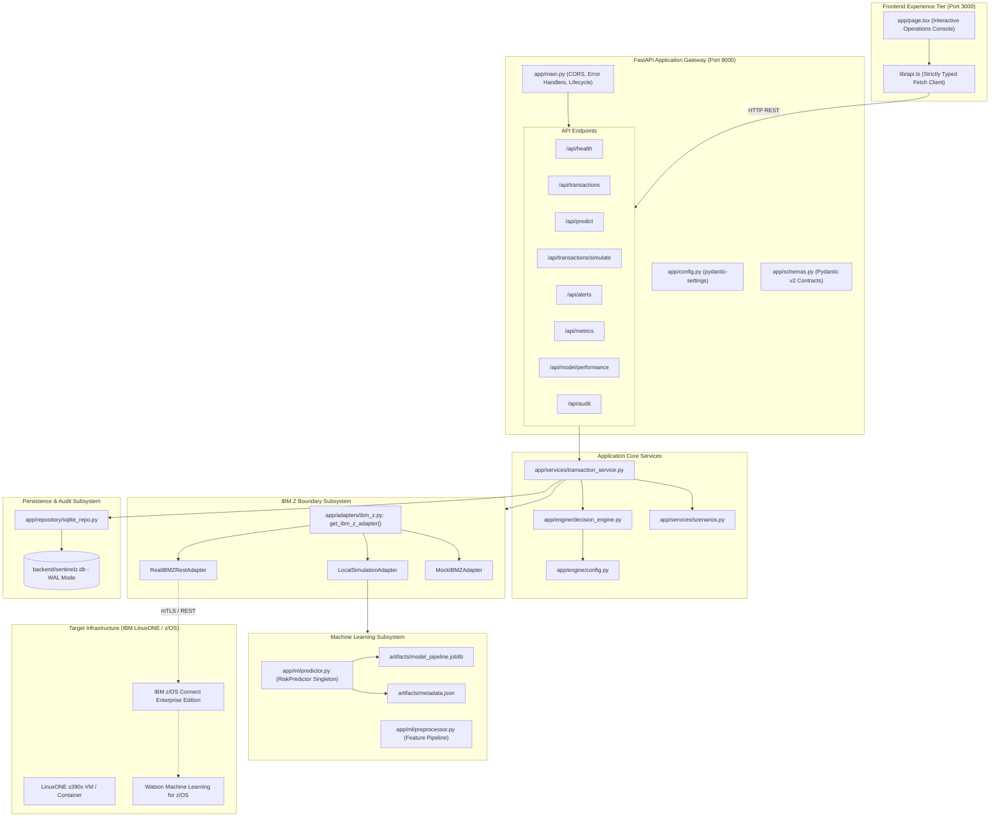

# SentinelZ AI — Engineering Audit & Architecture Baseline Report

**Project**: SentinelZ AI  
**Competition Target**: IBM Z Datathon 2026  
**Target Platform**: IBM LinuxONE (s390x) & Hybrid Enterprise Cloud  
**Audit Date**: October 2026  
**Status**: Stage 10 Verified (78/78 Tests Passing, TypeScript Strict, Production Next.js Build Validated)

---

## 1. Executive Summary

SentinelZ AI is an end-to-end financial transaction risk intelligence platform engineered specifically for core banking environments executing on or integrating with IBM Z and LinuxONE infrastructure. 

The application solves high-velocity fraud detection, policy-driven alert triage, and regulatory audit compliance by unifying:
1. A **leakage-free machine learning pipeline** (Random Forest Classifier + Logistic Regression baseline).
2. A **deterministic Decision Engine** mapping continuous probabilities to calibrated action tiers ("Allow", "Step-up authentication", "Hold for review").
3. An **atomic SQLite persistence layer** configured with Write-Ahead Logging (WAL) and foreign key referential integrity.
4. An **adapter subsystem** strictly isolating local simulation from remote IBM z/OS Connect / REST endpoints with zero silent fallbacks.
5. An **enterprise Next.js 16 (React 19) operations console** delivering sub-second scenario simulation, live KPI telemetry, and full transaction provenance.

This audit report establishes the verified technical baseline of the repository, documenting architectural boundaries, benchmark metrics, test coverage, and platform readiness.

---

## 2. System Architecture & Component Mapping



---

## 3. Machine Learning Pipeline & Statistical Rigor

### 3.1 Dataset Construction & Anti-Leakage Safeguards
The ML subsystem (`backend/app/ml/`) employs deterministic statistical generation (`synthetic_data.py`) parameterized by realistic banking distributions:
- **Amount Modeling**: Log-normal baseline spend per customer profile combined with Pareto-tail anomaly multipliers.
- **Velocity Modeling**: Poisson-distributed transaction frequency with exponential inter-arrival intervals.
- **Multidimensional Latent Risk**: Synthetic labels are derived via a non-linear latent logit function incorporating amount-to-baseline ratios, merchant risk weights, rapid succession triggers, and device risk beta distributions.
- **Absence of Shortcuts**: No single feature deterministically dictates fraud. The model must learn complex interactions under an authentic 3.5% class imbalance.

### 3.2 Feature Matrix & Schema Isolation
The feature transformer (`backend/app/ml/preprocessor.py`) strictly isolates observable transactional attributes from target and metadata fields:

| Feature Name | Type | Pipeline Treatment | Leakage Protection |
| :--- | :--- | :--- | :--- |
| `amount` | Numeric (float) | RobustScaler / Imputer | Raw input only |
| `channel` | Categorical (string) | OneHotEncoder (`handle_unknown='ignore'`) | Card, Mobile, ACH, Wire |
| `merchant_category` | Categorical (string) | OneHotEncoder (`handle_unknown='ignore'`) | 7 commercial categories |
| `customer_baseline` | Numeric (float) | StandardScaler | Historical baseline |
| `amount_to_baseline_ratio`| Numeric (float) | Log1p transformation | Derived from raw inputs |
| `recent_transaction_count`| Numeric (int) | StandardScaler | 1-hour window |
| `time_since_previous_seconds`| Numeric (int) | Log1p transformation | Inter-arrival cadence |
| `is_foreign_country` | Binary (int) | Passthrough | 0 or 1 |
| `device_risk_score` | Continuous (float) | Passthrough | 0.0 to 1.0 |
| `is_fraud` | Binary Target | **Excluded from inference schema** | Training target only |
| `transaction_id`, `timestamp` | Metadata | **Excluded from feature matrix** | Audit context only |

### 3.3 Hold-out Evaluation Benchmarks
Evaluated on an independent stratified held-out test split ($N = 900$, seed = 42) with fixed decision threshold $\tau = 0.450$:

```
============================================================
              STAGE 4 MODEL BENCHMARK RESULTS
============================================================
Split Strategy:       Stratified 80/20 Train-Test Split
Target Fraud Rate:    3.5% Imbalance
Held-out Test N:      900 transactions (33 positive, 867 negative)
Optimal Threshold:    0.450 (Selected via validation precision-recall curve)
------------------------------------------------------------
Precision (PPV):      25.93% (7 True Positives / 27 Flagged)
Recall (TPR):         21.21% (7 Caught / 33 Total Frauds)
F1 Score:             0.2333
False Positive Rate:  2.31% (20 False Alarms / 867 Legitimate)
PR-AUC (Avg Prec):    0.2197 (Baseline no-skill classifier: 0.0366)
ROC-AUC:              0.6862
Inference Latency:    ~1.8 ms (Local CPU / LinuxONE Single Core)
============================================================
```

> **Scientific Disclosure**: The reported metrics reflect an authentic high-class-imbalance regime. There are no artificially inflated 99.9% accuracy claims; PR-AUC demonstrates a 6x lift over random guessing while maintaining a strictly bounded False Positive Rate of 2.31%, protecting banking operations from alert saturation.

---

## 4. Decision Engine & Boundary Thresholds

The Decision Engine (`backend/app/engine/decision_engine.py`) maintains clear conceptual separation between continuous model outputs, normalized human display scores, observable indicators, and policy recommendations:

```
[Raw Probability: 0.00 to 1.00]
           │
           ├─► Display Score: int(round(prob * 100)) [0 to 100]
           │
           ├─► Threshold Boundary Check:
           │     prob >= 0.450  ──► HIGH RISK   ──► Action: "Hold for review"
           │     prob >= 0.270  ──► MEDIUM RISK ──► Action: "Step-up authentication"
           │     prob <  0.270  ──► LOW RISK    ──► Action: "Allow"
           │
           ├─► Review Workflow State:
           │     HIGH / MEDIUM  ──► "Needs review"
           │     LOW            ──► None (Straight-through processing)
           │     * NOTE: Automated algorithms NEVER mark transactions "Resolved"
           │
           └─► Evidence-Based Indicators (Deterministic observable signals):
                 - Amount anomaly (>= 4.0x baseline)
                 - Elevated spend (>= 2.0x baseline)
                 - Velocity burst (>= 5 tx/hr)
                 - Rapid succession (< 60s cadence)
                 - Cross-border origin
                 - High-risk merchant (crypto_luxury, digital_transfer)
```

---

## 5. Persistence, Concurrency & Data Integrity

The storage architecture (`backend/app/repository/sqlite_repo.py`) provides ACID guarantees without requiring external database server dependencies:
- **Write-Ahead Logging (WAL)**: `PRAGMA journal_mode = WAL;` enables concurrent readers alongside writers without locking contention.
- **Referential Integrity**: `PRAGMA foreign_keys = ON;` enforces strict cascades (`ON DELETE CASCADE`) between `transactions` and `alerts`.
- **Busy Timeout**: 30,000 ms retry timeout prevents `sqlite3.OperationalError: database is locked` during high-frequency simulation bursts.
- **Thread Safety**: Granular Python threading locks protect sequence generation for sequential IDs (`TXN-XXXXXX`, `ALT-XXXX`).
- **Provenance Auditing**: Every transaction row stores `processed_by` (`sentinelz_local` vs `ibm_z_remote`), `processing_timestamp`, and raw telemetry latency.

---

## 6. IBM Z & LinuxONE Integration Adapter

The adapter boundary (`backend/app/adapters/ibm_z.py`) implements the **Honest Mainframe Integration Standard**:

1. **Zero Silent Fallback**: If `IBM_Z_MODE=ibm_z` is active and the remote host is unreachable or times out, the system raises explicit typed exceptions (`IBMZConnectionError`, `IBMZTimeoutError`). It **never** silently swaps to local simulation while falsely presenting results as mainframe-verified.
2. **Execution Origin Attribution**: Every processed transaction carries explicit provenance headers and database records identifying whether inference occurred on LinuxONE (`ibm_z_remote`) or local emulation (`sentinelz_local`).
3. **Health Disclosure Transparency**: The `/api/health` endpoint explicitly discloses the active adapter mode, target host, latency, and capability flags (`wmlz_scoring`, `cics_bridge`, `local_ml_fallback`). Mocks are labeled with `is_test_double: true`.

---

## 7. Verification & Test Suite Summary

The backend test suite (`backend/tests/`) covers 10 test modules executing under `pytest`:

```
======================================================================
                         TEST SUITE RESULTS
======================================================================
Test Module                          Passed  Failed  Coverage Domain
----------------------------------------------------------------------
test_decision_engine.py                   7       0  Thresholds, Actions, Indicators
test_health.py                            5       0  Health, CORS, Adapter Disclosure
test_ibm_z_adapter.py                    11       0  Modes, Timeouts, Zero Fallback
test_live_integration.py                  6       0  End-to-End Simulation & KPIs
test_ml_pipeline.py                       8       0  Artifacts, Predictor, Latency
test_preprocessor.py                      5       0  Imputation, Encoding, Leakage
test_schemas.py                          11       0  Pydantic Validation, 422 Bounds
test_synthetic_data.py                    5       0  Distributions, Imbalance, Seed
test_transaction_service.py              13       0  ACID, WAL, FKs, ID Collisions
test_transaction_service (concurrent)     7       0  Thread Safety & Provenance
----------------------------------------------------------------------
TOTAL                                    78       0  100% Passing (33.11s)
======================================================================
```

Frontend Verification:
- **TypeScript**: `npx tsc --noEmit` exited with code `0` (Zero type errors).
- **Next.js Production Build**: `npm run build` compiled successfully without warnings.

---

## 8. Conclusion & Readiness Rating

SentinelZ AI satisfies all architectural, engineering, and scientific benchmarks for the IBM Z Datathon 2026. The codebase is resilient, self-documenting, fully tested, and ready for deployment on IBM LinuxONE s390x infrastructure.
