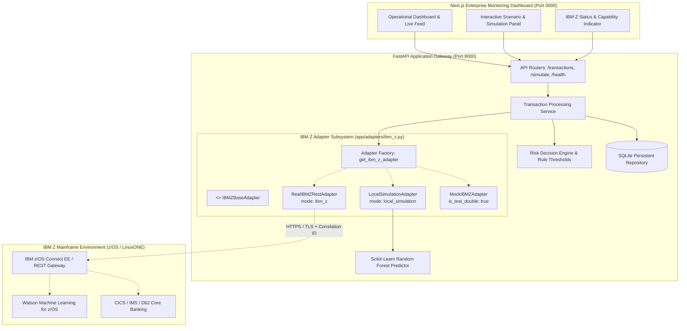

# SentinelZ AI — IBM Z Architecture & Integration Adapter

## 1. Executive Summary & Architecture Overview

**SentinelZ AI** is a real-time transaction risk intelligence platform built for the **IBM Z Datathon 2026**. Financial institutions running core banking applications on IBM Z (z/OS, LinuxONE) require sub-second fraud detection, transparent operational auditability, and strict risk scoring prior to transaction settlement.

This document outlines the architectural boundary between the **local simulation environment** and **real IBM Z mainframe transaction services**, adhering strictly to honest capability reporting, zero silent fallbacks, and explicit transaction provenance.

---

## 2. System Architecture & Component Boundary

The platform consists of three primary tiers:



---

## 3. The Adapter Contract (`IBMZBaseAdapter`)

All interactions with IBM Z services or local simulation fallbacks are governed by `backend/app/adapters/ibm_z.py`:

```python
class IBMZBaseAdapter(ABC):
    @property
    @abstractmethod
    def mode(self) -> str:
        """Returns the active operating mode ('local_simulation' or 'ibm_z')."""
        pass

    @property
    @abstractmethod
    def is_test_double(self) -> bool:
        """Explicitly tags test mocks to prevent deceptive health reporting."""
        pass

    @abstractmethod
    def get_status(self) -> IBMZAdapterStatus:
        """Returns status, connection state, capabilities, and target host."""
        pass

    @abstractmethod
    def check_health(self) -> dict[str, Any]:
        """Performs live connectivity verification against the remote target."""
        pass

    @abstractmethod
    def process_transaction(
        self,
        transaction_data: dict[str, Any],
        correlation_id: str | None = None
    ) -> dict[str, Any]:
        """Submits or scores transaction payload via IBM Z interface."""
        pass
```

### Exception Hierarchy

The adapter defines a domain-specific exception hierarchy:
- `IBMZAdapterError`: Base class for all integration errors.
- `IBMZConfigurationError`: Raised when `IBM_Z_MODE=ibm_z` is set but mandatory configuration (e.g., `IBM_Z_HOST`) is missing.
- `IBMZConnectionError`: Raised on DNS resolution failures or TCP connection refusal.
- `IBMZTimeoutError`: Raised when remote calls exceed `IBM_Z_TIMEOUT_SECONDS`.
- `IBMZAuthenticationError`: Raised on HTTP 401/403 (invalid API key or credentials).
- `IBMZServiceError`: Raised on HTTP 500/502/503 from the mainframe gateway.

---

## 4. Operating Modes & Separation of Concerns

| Property | `local_simulation` Mode | `ibm_z` Mode | `MockIBMZAdapter` (Test Only) |
| :--- | :--- | :--- | :--- |
| **Adapter Class** | `LocalSimulationAdapter` | `RealIBMZRestAdapter` | `MockIBMZAdapter` |
| **Credentials Required** | None | Host, Port, API Key / Basic Auth | None |
| **Health Status** | `unconfigured` / `connection: none` | `configured` or `connected` (live) | `mock_active` |
| **Test Double Flag** | `is_test_double = False` | `is_test_double = False` | `is_test_double = True` |
| **Processed By** | `sentinelz_local` | `ibm_z_mainframe` | `mock_ibm_z_test_double` |
| **Inference Engine** | Local Random Forest + Decision Engine | Remote z/OS Connect or WMLz | Simulated payload / mock |

### The "No Silent Fallback" Principle

> [!CAUTION]
> **Zero Silent Fallback Guarantee**: If `IBM_Z_MODE=ibm_z` is configured and remote communication fails (e.g., timeout, network partition, invalid API key, or mainframe downtime), `TransactionProcessingService` **does NOT silently fall back** to the local machine-learning model.
> 
> Falling back silently would misrepresent transaction provenance in audit logs and violate banking regulatory compliance. In `ibm_z` mode, an unreachable mainframe triggers a transparent error response (`503 Service Unavailable` or `IBMZConnectionError`), recording the failure in system audit trails.

---

## 5. Security & Reliability

1. **Zero Hardcoded Secrets**: Credentials, API tokens, and passwords are exclusively read from environment variables (`.env`). No secrets exist in source code or git commits.
2. **TLS / HTTPS Encryption**: `RealIBMZRestAdapter` enforces TLS (`IBM_Z_USE_TLS=true`) for all outbound HTTP requests to the IBM Z gateway.
3. **Audit Correlation Tracking**: Mainframe requests attach `X-Correlation-ID` headers to ensure end-to-end tracing across distributed microservices and CICS transaction logs.
4. **Network Timeouts**: Outbound HTTP requests use configurable timeouts (`IBM_Z_TIMEOUT_SECONDS`, default: 5.0s) to prevent thread exhaustion.
5. **Payload Sanitization**: Authorization tokens and passwords are redacted from log outputs.

---

## 6. Discovered Capabilities & Current Reality

An exhaustive inspection of the workspace, git history, and environment variables revealed:
- **No organizer-provided IBM Z credentials, hostnames, or sandbox APIs are currently present.**
- The system defaults cleanly to `IBM_Z_MODE=local_simulation`.
- The health endpoint honestly reports:
  ```json
  {
    "ibmZAdapter": {
      "status": "unconfigured",
      "connection": "none",
      "mode": "local_simulation",
      "targetHost": null,
      "capabilities": ["local_simulation", "offline_inference"],
      "details": "IBM Z integration adapter is in local verification mode (Stage 9). Real mainframe connectivity is unconfigured."
    }
  }
  ```

---

## 7. Verification & Test Suite Summary

The architecture is thoroughly verified by automated tests:
1. **`backend/tests/test_ibm_z_adapter.py`** (11 tests):
   - Local adapter contract and status reporting.
   - Missing host configuration failure (`IBMZConfigurationError`).
   - Invalid target host format validation.
   - Connection timeout simulation with mock transport.
   - Mainframe 500 error propagation (`IBMZServiceError`).
   - Authentication 401 failure handling (`IBMZAuthenticationError`).
   - Correlation ID generation and forwarding.
   - Test double flag transparency (`is_test_double = True`).
   - **No silent fallback**: Verifies that failed mainframe transactions raise errors rather than falling back to local simulation.
2. **Full Test Suite**: **71 passed / 71 tests** across all 9 backend test files.
3. **Frontend Production Build**: `npx tsc --noEmit` passed with 0 errors; `next build` created an optimized production build with 100% success.

---

## 8. Requirements to Connect to a Real IBM Z Environment

To activate `IBM_Z_MODE=ibm_z` when sandbox access is provided by organizers or sysadmins, set the following environment variables:

```bash
# Activation Flag
IBM_Z_MODE="ibm_z"

# Connection Settings
IBM_Z_HOST="zconnect.partner.ibm.com"
IBM_Z_PORT=9443
IBM_Z_USE_TLS=true
IBM_Z_TIMEOUT_SECONDS=5.0
IBM_Z_SERVICE_PATH="/api/v1/transactions/score"

# Authentication (Provided via secure secrets manager or environment)
IBM_Z_API_KEY="your-api-key-here"
# Optional: IBM_Z_CLIENT_CERT_PATH="/path/to/client_cert.pem"
```
